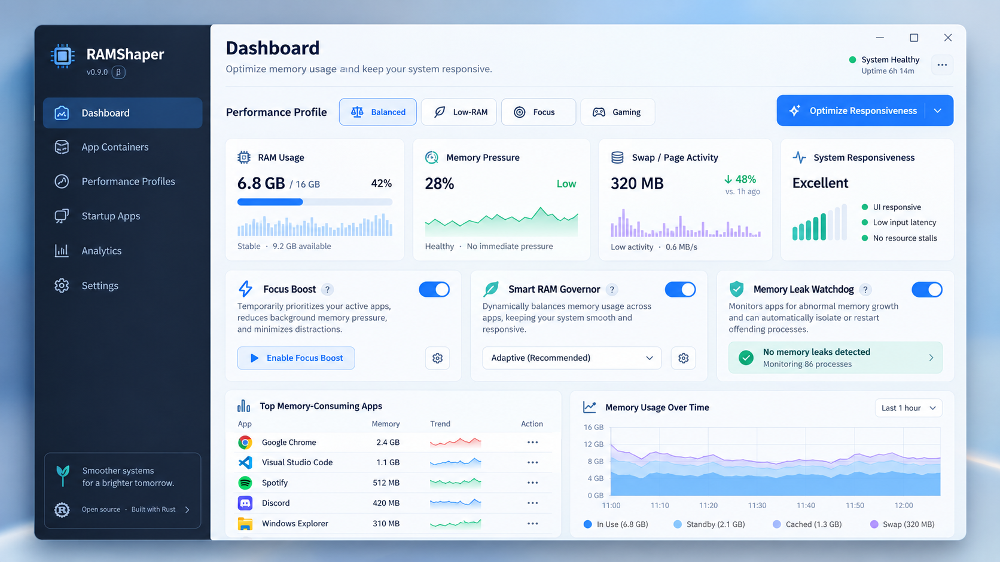

# RAMShaper — Project Documentation

**Revision:** 0.3.36 • **Updated:** October 26, 2026  
**Status:** read-only CLI (**G0 passed**); observation increment (**G1 partially verified**: AT-06 deterministic, AT-07, AT-08 core/config Passed — the 24-hour soak and declared 4/8/16 GiB cohorts remain open); session agent + IPC (RS-030); read-only Slint UI (Overview / Applications / Profiles / Actions, RS-010–013 slices; interactive accessibility pass open); **policy stage code-complete behind typed session consent** (RS-015–019, RS-031, RS-016–018 engines, G3 glue — the compatibility allowlist ships empty until Stage B evidence exists); managed-launch spike (RS-020); benchmark harness with the Stage B runner (RS-024). Executed evidence for every claim: [16](docs/16_IMPLEMENTATION_EVIDENCE.md).  
**Direction:** Rust + Slint UI; Windows x64 first  
**Name/license:** working name; project license and distribution review remain open

RAMShaper is an offline resource monitor and an optional, consent-gated workload manager. Its intended outcome is improved responsiveness under measured contention. It cannot create physical RAM, guarantee performance gains, or security-sandbox arbitrary applications. Agents start Observe Only; policy enabling is a typed per-session console act (`ENABLE`), never a flag, file or IPC command.

## Start here

- Build and run: [BUILDING.md](../BUILDING.md). What the tools store and send (nothing): [FAQ and privacy](../FAQ_AND_PRIVACY.md). Contributing: [CONTRIBUTING.md](../CONTRIBUTING.md).
- Plan and status: the [implementation readiness review](docs/00_IMPLEMENTATION_READINESS.md), the [roadmap and backlog](docs/07_MVP_ROADMAP_AND_BACKLOG.md) and the [acceptance matrix](docs/15_ACCEPTANCE_TEST_MATRIX.md).
- The [PRD](docs/02_PRODUCT_REQUIREMENTS.md) defines scope; [runtime contracts](docs/14_RUNTIME_CONTRACTS.md) define exact behavior.

## Canonical documentation

| Document | Purpose |
|---|---|
| [00 — Implementation readiness](docs/00_IMPLEMENTATION_READINESS.md) | Authority, release slices, unresolved decisions and risks |
| [01 — Research and feasibility](docs/01_RESEARCH_AND_FEASIBILITY.md) | Initial evidence, competitors and limits |
| [02 — Product requirements](docs/02_PRODUCT_REQUIREMENTS.md) | User stories, release scope, acceptance and non-goals |
| [03 — System architecture](docs/03_SYSTEM_ARCHITECTURE.md) | Boundaries, crate responsibilities and data flow |
| [04 — Windows API implementation](docs/04_WINDOWS_API_IMPLEMENTATION.md) | API mapping, rights, launch strategy and spikes |
| [05 — Linux/macOS roadmap](docs/05_LINUX_MACOS_ROADMAP.md) | Deferred platform capabilities; no parity promise |
| [06 — UI/UX design](docs/06_UI_UX_DESIGN_SPEC.md) | Screens, user control, accessibility and error states |
| [07 — Roadmap and backlog](docs/07_MVP_ROADMAP_AND_BACKLOG.md) | Ticket dependencies and release gates |
| [08 — Benchmarks and validation](docs/08_BENCHMARKS_AND_VALIDATION.md) | Reproducible evidence and regression criteria |
| [09 — Security, privacy and safety](docs/09_SECURITY_PRIVACY_AND_SAFETY.md) | Mandatory safeguards and recovery/privacy limits |
| [10 — Business plan](docs/10_OPEN_SOURCE_BUSINESS_PLAN.md) | Unvalidated market, pricing and licensing options |
| [11 — Developer handoff](docs/11_AI_DEVELOPER_BUILD_PROMPT.md) | Incremental implementation contract for future work |
| [12 — Source register](docs/12_SOURCES.md) | Primary URLs and per-source verification status |
| [13 — Architecture decisions](docs/13_ARCHITECTURAL_DECISIONS.md) | Required constraints, selected designs and open decisions |
| [14 — Runtime contracts](docs/14_RUNTIME_CONTRACTS.md) | Metrics, consent, journal, IPC, storage and CLI semantics |
| [15 — Acceptance matrix](docs/15_ACCEPTANCE_TEST_MATRIX.md) | Requirement/ticket/test traceability and evidence template |
| [16 — Implementation evidence](docs/16_IMPLEMENTATION_EVIDENCE.md) | Executed evidence for every landed slice: G0/G1 cases, IPC, UI, journal, eligibility, policy engines, consent path, boundary reviews — with the not-run registry kept honest |

The [master reference](RAMShaper_Master_Reference.md) is a reading guide. The [original product research](RAMShaper_Product_Research_Document.md) is retained as historical context and is not an implementation specification. See [CHANGELOG.md](CHANGELOG.md) for this revision.

## Delivery sequence

1. ~~Read-only CLI and Windows error-handling evidence~~ — **G0 passed 2026-10-23**.
2. ~~Process telemetry, bounded history and observer-overhead baseline~~ — **implemented; G1 awaits the 24-hour soak and declared cohorts**.
3. ~~Native observation UI and inert profile settings~~ — **shipped as slices** (Overview/Applications/Profiles/Actions; license pick and the interactive accessibility pass remain).
4. ~~One manually approved temporary CPU-priority policy, after recovery tests~~ — **code-complete behind typed session consent**; the allowlist ships empty until Stage B testing; the consent-driven UI flow is the remaining owner-gated piece.
5. Managed launch beta, after Job lifetime/compatibility tests — **RS-020 spike done**; RS-021–023 open.
6. Full benchmark wizard and evidence-backed release — **Stage A + Stage B runner landed**; cohorts, quantiles/CI wizard and packaging open.

Benchmark instrumentation begins in the observation phase. No automatic optimization is authorized by selecting a profile or importing settings.

## Visual concepts

The four images in [design](design/01_dashboard.png) are generated visual references with synthetic numbers and some unapproved controls. The written UI spec governs behavior. Keep automatic restarts, periodic cache trimming, hard quotas and unmeasured benefit badges out of the implementation.

## Working in this package

The workspace has a documentation package at `docs/`, with the canonical numbered documents at `docs/docs/`. The application increment (Cargo workspace, `crates/ramshaper-core|platform|windows|cli|agent|ui|bench|journal`, CI, `BUILDING.md`) lives at the workspace root; the documentation was not moved. Build commands and prerequisites are in the root `BUILDING.md`; executed evidence is in [16](docs/16_IMPLEMENTATION_EVIDENCE.md); raw artifacts per slice are under `docs/evidence/`.

For every implemented increment, record commands, exit codes, Windows build, privileges, source revision and evidence artifacts. Preserve failed, neutral and unavailable results. Read [AGENTS.md](AGENTS.md) before implementation. No software license or dependency approval is implied by these planning files.